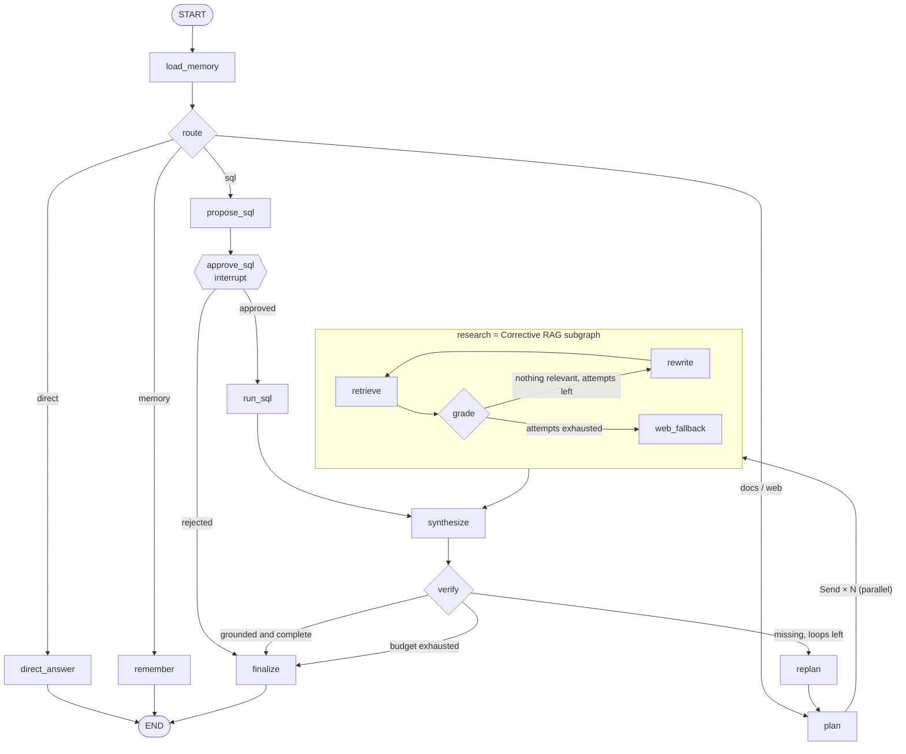

<div align="center">

# open-agentic-rag

**Open-source agentic RAG built on LangGraph: an agent that routes, plans, retrieves in parallel, checks its own answers and asks a human before acting.**

Query routing · multi-step planning · Corrective RAG · answer verification · text-to-SQL with human approval · long-term memory · budgets · durable state · FastAPI · LangSmith

[](https://github.com/w4coder/open-agentic-rag/actions/workflows/ci.yml)
[](LICENSE)


[](https://github.com/w4coder/open-rag)

[Quickstart](#quickstart) · [What the agent does](#what-the-agent-does) · [Architecture](#architecture) · [Production](#production) · [Patterns](docs/patterns.md) · [Français](README.fr.md)

</div>

---

A linear RAG pipeline answers one question with one search. Real questions are messier: two questions in one, a retriever that returns noise, a request that needs a database query, a user preference to remember. **open-agentic-rag** turns RAG into an **agent** that decides what to do, does it in parallel, checks the result, and stops within a budget, with the guardrails a production system needs.

It reuses the hybrid search, chunking and Qdrant index of [**open-rag**](https://github.com/w4coder/open-rag), benchmarked at 90% correct answers on the 1,914 text questions of Open RAG Bench.

```bash
python -m agentic_rag.cli "What is the Business plan rate limit and what is the Enterprise availability SLA?"
```

```json
{
  "status": "ok",
  "answer": "The default rate limit is 600 requests per minute per project. The Business plan raises it to 3000 requests per minute and the Enterprise plan to 20000 requests per minute. The availability SLA is 99.95 percent for the Business plan and 99.99 percent for the Enterprise plan. Cross-region replication is asynchronous with a typical lag below 5 seconds.",
  "citations": [{"source": "storage.md", "kind": "doc"}, {"source": "operations.md", "kind": "doc"}],
  "trace": ["load_memory", "route", "plan", "research:retrieve>grade", "research:retrieve>grade", "synthesize", "verify"]
}
```

Two sub-questions, two searches in parallel, one verified answer with its sources. Offline, no API key.

## What the agent does

| Question | Path through the graph |
|---|---|
| "Hello" | route → direct answer, no search |
| "What does error NB-4021 mean?" | route to docs → plan (1 step) → Corrective RAG → synthesis → verification |
| "Business plan limit **and** Enterprise SLA?" | plan (2 sub-questions) → **2 searches in parallel** → synthesis |
| A question the documents cannot answer | Corrective RAG: rewrite → web fallback → replan (bounded) → honest refusal |
| "What was the total revenue in Q1 by region?" | text-to-SQL → **validation** → ⏸ **human approval** → read-only execution |
| "What is the status of incidents?" | route to web → web search (offline stub) |
| "Remember that I prefer French" | long-term memory (store) |

## Why open-agentic-rag

| | What you get |
|---|---|
| **Adaptive routing** | Each question takes the path it needs: direct answer, documents, SQL, web or memory. |
| **Multi-hop questions** | A planner splits compound questions; LangGraph `Send` runs the searches in parallel and merges the evidence. |
| **Corrective RAG** | Retrieved passages are graded; on noise the agent rewrites the query, falls back to the web, and replans within a bounded number of loops. |
| **Self-checking answers** | A verifier checks grounding and completeness before answering, and replans what is missing. |
| **Safe tools** | Text-to-SQL is read-only by construction: SQL parser validation, table allow-list, row cap, database authorizer. |
| **Human in the loop** | Sensitive actions pause with `interrupt()` and resume after approval (`/v1/resume`), with an approver role and four-eyes rule. |
| **Memory** | Short-term memory per thread (checkpointer) and long-term user preferences (store), filtered before use. |
| **Bounded cost** | Step, loop and token budgets per run and per day, rate limits, guaranteed termination. |
| **Testable without an LLM** | Every decision sits behind a `Brain` interface: deterministic heuristics for tests and CI, an LLM with structured output in production. |

## Quickstart

Offline, no API key:

```bash
git clone https://github.com/w4coder/open-agentic-rag.git && cd open-agentic-rag
python -m venv .venv && . .venv/bin/activate        # Windows: .venv\Scripts\activate
pip install -r requirements-dev.lock && pip install --no-deps -e .   # pinned, includes open-rag v0.3.0
cp .env.example .env
pytest -q                                            # topology, security, budgets, durability, LLM resilience
python -m evals.run_eval                             # agent vs single-shot RAG: answer, trajectory, cost
python -m agentic_rag.cli "What was the total revenue in Q1 by region?"   # asks for human approval
uvicorn agentic_rag.api:app --reload                 # POST /v1/ask, then POST /v1/resume
```

With a real LLM, set in `.env`:

```env
AGENT_LLM_PROVIDER=openai
OPENAI_API_KEY=sk-...
```

The same decisions (router, planner, grader, verifier) are then made by the LLM through structured output.

## Architecture



| Path | Role |
|---|---|
| [`src/agentic_rag/graph.py`](src/agentic_rag/graph.py) | Main graph: router, planner, `Send` fan-out, synthesis, verification, replan, human approval, memory |
| [`src/agentic_rag/crag.py`](src/agentic_rag/crag.py) | Corrective RAG subgraph: retrieve → grade → rewrite or web fallback |
| [`src/agentic_rag/brain.py`](src/agentic_rag/brain.py) | All decisions behind one interface: `HeuristicBrain` and `LLMBrain` |
| [`src/agentic_rag/tools.py`](src/agentic_rag/tools.py) | Tools: documents (open-rag retrieval), safe SQL, web; one evidence schema |
| [`src/agentic_rag/service.py`](src/agentic_rag/service.py) | Execution, resume after interrupt, budgets, LangSmith config |
| [`evals/`](evals/) | Dataset, answer / trajectory / cost evaluation, single-shot baseline |
| [`docs/`](docs/) | [Patterns catalogue](docs/patterns.md), evaluation, ADRs, tutorial |

## Production

- **Identity and access**: API keys per user (`AGENT_API_KEYS`), private threads, `approver` role with four-eyes approval.
- **Durable state**: LangGraph checkpoints in SQLite or Postgres (`AGENT_CHECKPOINT_URL`), so any replica can resume a paused run.
- **Shared index**: set `RAG_QDRANT_URL` to search the same Qdrant index as your [open-rag](https://github.com/w4coder/open-rag) deployment.
- **Budgets**: steps, tokens per run, tokens per day and rate limits, shared through Redis.
- **Deploy**: [`deploy/docker-compose.yml`](deploy/docker-compose.yml) runs the agent with Postgres, Qdrant and Redis.
- **Observability**: LangSmith traces (`LANGSMITH_TRACING=true`) show every node, the CRAG subgraph and each LLM call, tagged by brain and grouped by thread; Prometheus metrics on `/metrics`.

See the [tutorial](docs/tutorial.md) and the [production review](docs/production-review.md).

## Status and limits

- The heuristic brain is covered by the test suite. The LLM brain is evaluated with `python -m evals.run_eval --langsmith` and its resilience is tested with stubs, but **no real-LLM quality figures are published yet**: a benchmark like open-rag's is next.
- The Postgres checkpointer is not covered by automated tests (SQLite is, with the same LangGraph contract).
- The demo SQL database is in-memory SQLite: on a real warehouse, keep the same defence with a read-only role, per-table grants and `statement_timeout`.

## FAQ

**What is agentic RAG?** Retrieval-Augmented Generation where an agent decides how to answer: which source to use, whether to split the question, whether the retrieved passages are good enough, and whether the answer is complete, instead of running one fixed search-then-generate pipeline.

**How is it different from open-rag?** open-rag is the retrieval and answer engine: hybrid search, reranking, citations, guardrails, multi-tenant API. open-agentic-rag adds the agent on top: routing, planning, Corrective RAG, verification, tools, human approval and memory.

**Do I need an LLM to try it?** No. The heuristic brain runs the whole graph offline; switch to an LLM with one variable.

## Contributing

Issues and pull requests are welcome. Run `pytest -q` and `ruff check src tests evals` before opening a PR; the CI regression gate must stay green.

If open-agentic-rag is useful to you, **give it a star** ⭐: it helps others find it.

## License

[Apache License 2.0](LICENSE).
