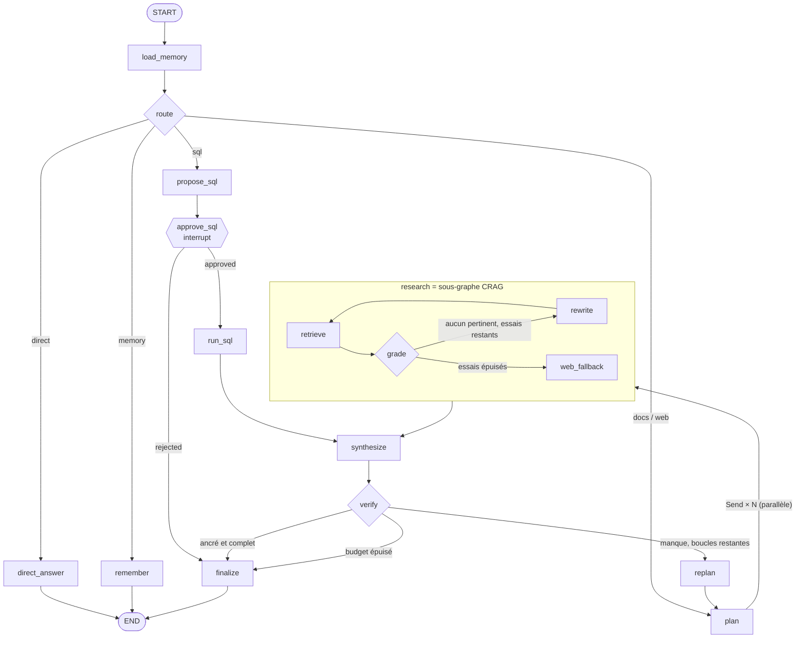

# Catalogue des patterns agentiques (et où les lire dans le code)

| # | Pattern | Problème résolu | Où |
|---|---|---|---|
| 1 | **Adaptive RAG / routeur** | Toutes les questions ne méritent pas le même pipeline (bonjour ≠ calcul SQL ≠ doc) | `graph.py::route`, `brain.route` |
| 2 | **Décomposition + parallélisme (map-reduce)** | Questions multi-sauts : une seule recherche ne suffit pas | `graph.py::plan`, `fan_out` (`Send`), reducer `evidence` |
| 3 | **Corrective RAG (CRAG)** | Le retriever peut renvoyer du bruit : il faut le *détecter* et réagir | `crag.py` (grade → rewrite → web) |
| 4 | **Auto-réflexion (Self-RAG)** | Vérifier ancrage + complétude avant de répondre, replanifier ce qui manque | `graph.py::verify`, `replan` |
| 5 | **Outils sûrs** | Un agent agit : SQL en lecture seule par construction, allow-list, cap de lignes | `tools.py::validate_sql` |
| 6 | **Human-in-the-loop** | Valider une action sensible avant exécution | `graph.py::approve_sql` (`interrupt`) |
| 7 | **Mémoire court terme** | Reprendre un run / une conversation | checkpointer + `thread_id` (`service.py`) |
| 8 | **Mémoire long terme** | Préférences utilisateur persistantes inter-conversations | `store` (`load_memory`, `remember`) |
| 9 | **Budgets & arrêt garanti** | Une boucle d'agent non bornée = incident de coût | `max_loops`, `max_retrieval_attempts`, `recursion_limit` |
| 10 | **Cerveau interchangeable** | Tester la topologie sans LLM, évaluer la qualité avec | `brain.py` (Heuristic vs LLM) |

## Topologie

## Quand l'agentique vaut-il son coût ?
À mesurer, pas à supposer : `python -m evals.run_eval` compare l'agent à un RAG « single-shot » sur le même dataset (voir [evaluation.md](evaluation.md)).
Règle empirique : **RAG simple** pour Q/R documentaire mono-source ; **agentique** dès qu'il faut décomposer, router entre sources/outils, ou agir. Chaque boucle ajoute latence, coût et surface d'erreur.

## Sécurité spécifique aux agents
- **Principe du moindre privilège** pour les outils (SQL `SELECT` sur une table allow-listée, `PRAGMA query_only`).
- **Ne jamais faire confiance au contenu récupéré** (web/docs) : c'est de la donnée, pas des instructions (injection indirecte).
- **Approbation humaine** pour toute action irréversible/coûteuse.
- **Budget dur** (steps, tokens, temps) + traces LangSmith pour auditer chaque run.
